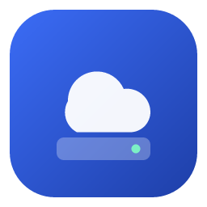
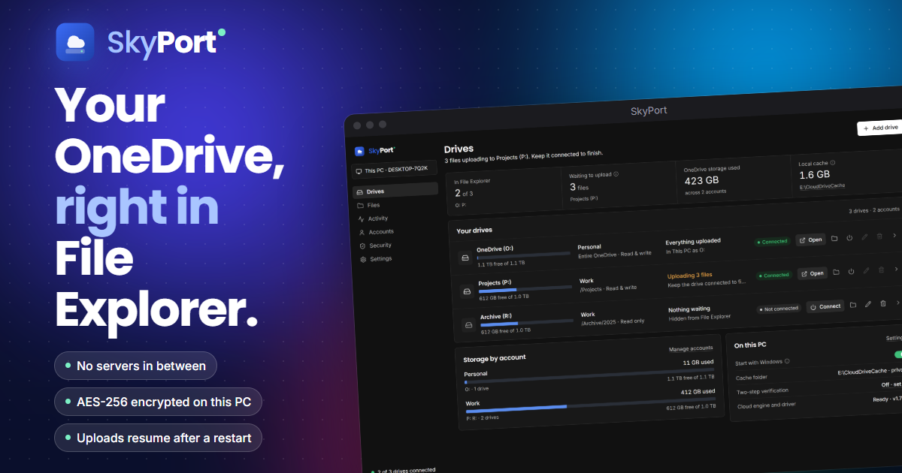
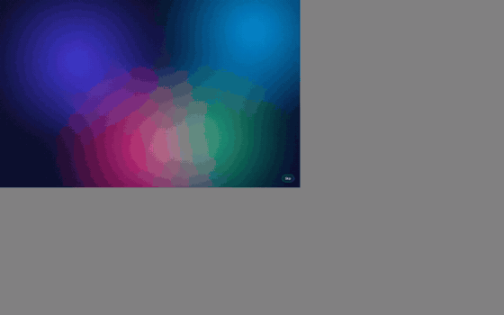
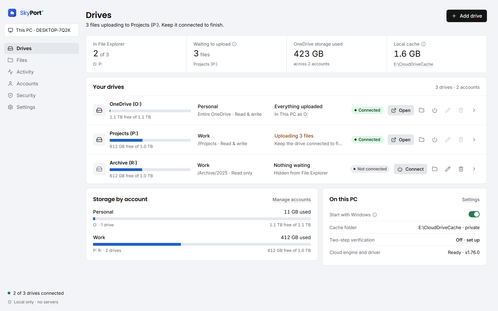
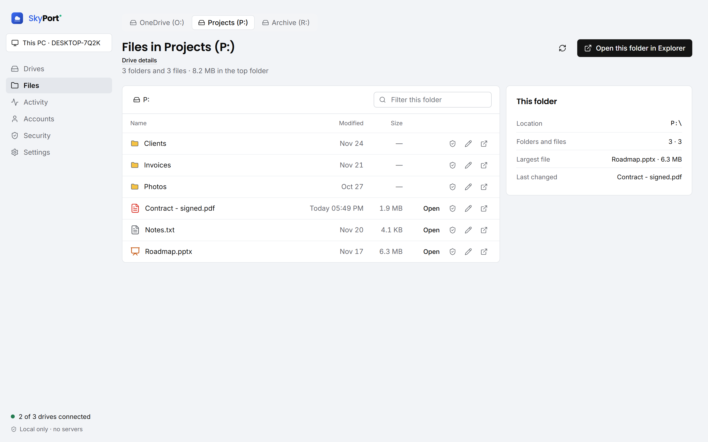
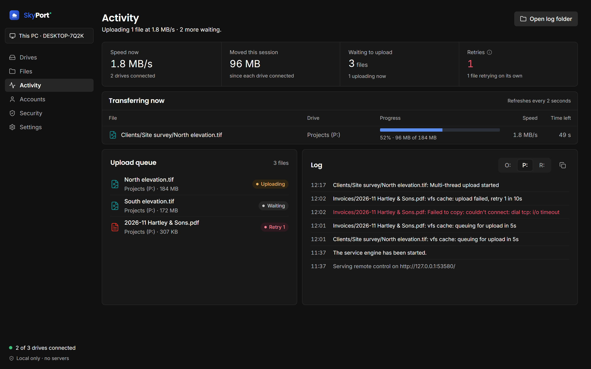
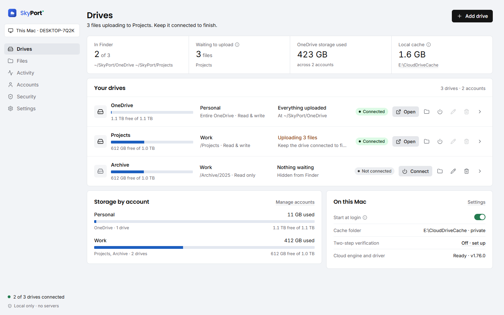

<p align="center">
  
</p>

<h1 align="center">SkyPort</h1>

<p align="center">
  <strong>Your OneDrive, right in File Explorer.</strong><br />
  No servers in between. Just sign in.
</p>

<p align="center">
  <a href="https://github.com/ks-rdz-07/app.skyport.desktop/actions/workflows/build.yml"></a>
  
  
  
  
  <br />
  <a href="../../releases/latest"></a>
  <a href="LICENSE"></a>
  <a href="../../actions/workflows/security.yml"></a>
  <br />
  <a href="../../releases"></a>
  <a href="../../graphs/traffic"></a>
  <a href="../../graphs/traffic"></a>
  <a href="../../graphs/traffic"></a>
  <a href="../../stargazers"></a>
  <a href="../../forks"></a>
</p>

<p align="center">
  
</p>

SkyPort is a desktop app that puts your OneDrive (Personal or for Business) on your computer as a real drive:
- **Windows:** a drive letter such as `O:` in This PC.
- **macOS and Linux:** a folder under `~/SkyPort`.

Files open on demand, and changes upload in the background. There are no SkyPort servers: your files go straight between your computer and Microsoft, and everything SkyPort keeps stays on your computer, encrypted.

Under the hood, [rclone](https://rclone.org) does the cloud and mount work. [WinFsp](https://winfsp.dev) or FUSE provides the filesystem driver. Rust ([Tauri 2](https://tauri.app)) manages processes, accounts and status, and the interface is React and TypeScript.

<p align="center">
  
</p>

## Features

<table>
  <tr>
    <td width="50%" valign="top">
      <h3>Drives in your file manager</h3>
      Mount the whole OneDrive or one folder, read and write or read only. Use several accounts and several drives at once. Each drive shows its storage, its uploads, and exactly where it is in File Explorer.
    </td>
    <td width="50%"></td>
  </tr>
  <tr>
    <td width="50%"></td>
    <td width="50%" valign="top">
      <h3>Files, inside the app</h3>
      Browse folders and files with type icons, sizes and dates. Open, rename, show in File Explorer, and scan for viruses with Microsoft Defender or ClamAV, whichever this computer has.
    </td>
  </tr>
  <tr>
    <td width="50%" valign="top">
      <h3>Uploads you can trust</h3>
      Changes are saved locally first and uploaded in the background. After a restart or a dropped connection, unfinished uploads pick up where they left off. The Activity screen shows live transfers, the upload queue and each drive's log.
    </td>
    <td width="50%"></td>
  </tr>
</table>

- **Private by design:** no SkyPort servers, no account and no tracking. Sign-ins, settings and history stay on your computer, encrypted with AES-256.
- **Two-step verification:** codes from any authenticator app, 8 single-use recovery codes, and a lock screen enforced in Rust. Drives stay connected while SkyPort is locked.
- **Private, hidden cache:** only your user account can open the cache folder.
- **Start at sign-in** in the system tray. Drives that were connected come back by themselves, and a drive that stops unexpectedly reconnects.
- **Light, dark or system theme**, a guided tour, and tooltips throughout.

## Platforms

| | Windows 10 / 11 | macOS | Linux |
|---|---|---|---|
| A drive appears as | a drive letter in This PC (`O:`) | a folder, `~/SkyPort/<name>` | a folder, `~/SkyPort/<name>` |
| Filesystem driver | [WinFsp](https://winfsp.dev/rel/) | [macFUSE](https://macfuse.github.io/) or FUSE-T | FUSE 3 (`fuse3` package) |
| Database key kept by | DPAPI (your Windows account) | Keychain | Secret Service, else a `0600` file |
| Cache made private by | folder permissions, hidden | `chmod 700` | `chmod 700` |
| Virus scanning | Microsoft Defender or ClamAV | ClamAV | ClamAV |
| Installers | Inno Setup, MSI, NSIS | `.dmg` | `.deb`, AppImage |

The interface uses each system's own words: Finder, This Mac, Start at login and so on.

<p align="center">
  <br />
  <sub>The macOS interface, shown in the development preview with sample data.</sub>
</p>

> [!NOTE]
> The macOS and Linux builds compile and pass their tests in CI, but mounting a drive hasn't been tried on a real Mac or Linux machine yet. The `.dmg` is unsigned, so macOS will warn when you first open it.

## Get started

### 1. Install the two components

| Component | Windows | macOS | Linux |
|---|---|---|---|
| rclone 1.60 or newer | [rclone.org](https://rclone.org/downloads/) or `winget install Rclone.Rclone` | `brew install rclone` | your package manager, or [rclone.org](https://rclone.org/downloads/) |
| Filesystem driver | [WinFsp](https://winfsp.dev/rel/) or `winget install WinFsp.WinFsp` | [macFUSE](https://macfuse.github.io/) or FUSE-T | `fuse3` |

SkyPort finds rclone next to the app, on `PATH`, in winget's package folder on Windows, and in Homebrew's folders on macOS. Click **Check again** on the Setup screen after installing.

### 2. Install SkyPort

Download an installer from the latest [release](https://github.com/ks-rdz-07/app.skyport.desktop/releases/latest), or build it yourself (see [Development](#development)). Each release lists its files and a `SHA256SUMS.txt`. The installers aren't code-signed yet, so Windows SmartScreen and macOS Gatekeeper warn on first open.

On Windows, run SkyPort **without** "Run as administrator". Drives mounted by an elevated app are hidden from your File Explorer, so SkyPort refuses to mount when elevated and shows a banner.

### 3. Add your OneDrive

1. Open SkyPort and click **Add drive**.
2. **Account:** pick an account, or give a new one a name and click **Sign in with Microsoft**. Finish signing in in your browser; SkyPort comes back to the front when you're done. Personal and work or school accounts both work.
3. **Folder:** *Entire OneDrive*, or *One folder* (browse and pick).
4. **Drive:**
   - a name
   - on Windows, a drive letter (letters already in use are crossed out)
   - access: *Read & write* or *Read only*
5. Click **Add and connect**. When the drive says **Connected**, it's in your file manager.

### 4. Make it yours

- **Settings → Appearance:** System, Light or Dark.
- **Settings → Local cache:** the default is a private, hidden folder in SkyPort's app data. You can move it to another drive, for example `E:\CloudDriveCache`, while no drive is connected. SkyPort refuses to move it while files are still waiting to upload.
- **Settings → Startup:** start in the tray at sign-in and reconnect every drive.
- **Security:** two-step verification.

Closing the window keeps your drives connected. Quit from the tray icon.

## Security

- **Sign-in tokens** stay in rclone's own config. Rust reads that config only to list account names and types, and drops the tokens immediately. The output of rclone's sign-in step, which ends with the token, is discarded, and rclone's error text is redacted before it reaches the interface.
- **No shell, ever:** every process is started directly with an argument vector. The interface can't pass URLs or programs; download links are fixed in Rust.
- **Each mount's control port** listens only on `127.0.0.1`, with a random user and password passed through the environment, never on the command line.
- **The encrypted database** is a SQLite file kept in memory and written to disk as AES-256-GCM ciphertext. Its key is held by the operating system (see [Platforms](#platforms)). If it can't be decrypted, it's set aside, never deleted.

### Where things live (Windows)

| What | Path |
|---|---|
| Encrypted database: drives, account names, settings, storage history, activity, two-step secret | `%LOCALAPPDATA%\app.skyport.desktop\skyport.db` |
| Database key (256-bit, DPAPI-wrapped to your Windows account) | `%LOCALAPPDATA%\app.skyport.desktop\vault.key` |
| Drive logs, one per drive | `%LOCALAPPDATA%\app.skyport.desktop\logs\` |
| Cache (pending uploads live here) | `%LOCALAPPDATA%\app.skyport.desktop\cache\` by default |
| OneDrive sign-in tokens | `%APPDATA%\rclone\rclone.conf`, managed by rclone |

## Installers

| Installer | Build | Notes |
|---|---|---|
| **Inno Setup**, recommended for people | `ISCC.exe installer\skyport.iss` after `pnpm tauri build` | Per-user, no admin rights. Checkboxes: start with Windows (on by default), desktop shortcut, launch when done. Theme: System, Light or Dark. Uninstall cleans up and asks about the cache. |
| **MSI**, for IT and silent installs | `pnpm tauri build` (WiX, downloaded by Tauri) | First-run choices as properties: `msiexec /i SkyPort_0.1.0_x64_en-US.msi STARTUP=0 THEME=dark /qn`. Doesn't remove app data on uninstall. Use Inno Setup or NSIS when that matters. |
| **NSIS** | `pnpm tauri build` | Per-user. Uninstall cleans up and asks about the cache. |
| **`.dmg`, `.deb`, AppImage** | CI, or `pnpm tauri build --bundles dmg` (or `deb,appimage`) on that system | |

The Windows installers hand their choices to SkyPort through `HKCU\Software\Skyport`. SkyPort applies them once at first launch and then deletes them, so later changes in Settings win.

**Uninstalling on Windows** removes SkyPort's app data (database, key, logs), its startup entry and its registry key. It **asks** before deleting the cache folder (default: keep), because the cache can hold edits that haven't uploaded yet. In-place updates skip all of this. Sign-ins in `rclone.conf` are left alone, because other tools may share that file; remove accounts in SkyPort first if you want them gone.

## Troubleshooting

- **"Drive O: is already in use":** another disk, mapped share or leftover engine holds the letter. Pick another letter in Edit.
- **The drive works in SkyPort but not in File Explorer:** SkyPort is probably running as administrator. Restart it normally.
- **Uploads seem stuck:** they retry on their own with back-off. Activity shows the queue, retries and each drive's log.
- **A drive stopped:** SkyPort reconnects it automatically, up to 3 tries. After that, click **Reconnect**. Pending changes are kept.

## Development

Needs Rust stable, Node 22+, pnpm, and on Windows the Visual Studio C++ Build Tools with WebView2 (built into Windows 11).

```powershell
pnpm install
pnpm tauri dev                 # run the app
pnpm build                     # type-check, class guard, front-end build
cd src-tauri; cargo test       # Rust tests
pnpm tauri build               # installers in src-tauri\target\release\bundle\
```

- **Browser preview:** `pnpm dev` without the Tauri shell runs the interface with sample data (`src/dev/mock.ts`, dev builds only).
  - Screens: `#/drives`, `#/files`, `#/activity`, `#/accounts`, `#/security`, `#/settings`, `#/drives/<id>`.
  - Options: `?theme=light|dark`, `?os=macos|linux` (preview another system's wording), `?splash=1` (show the opening animation).
- **Linux in a container:** `podman run --rm -v <project>:/src:ro -v skyport-target:/target docker.io/library/rust:1-bookworm sh /src/scripts/linux-check.sh`
- **CI** builds and tests Windows, macOS and Linux on every push (`.github/workflows/build.yml`).
- **Rebuilding while SkyPort runs** fails on Windows (`Access is denied` on `skyport.exe`), because Windows locks a running program's file. Quit SkyPort from the tray first, or build into another folder: `$env:CARGO_TARGET_DIR="src-tauri\target-dist"`.
- **Marketing images:** `marketing/template.html` renders the share image, social banners and ad sizes into `marketing/out/` with `node marketing/render.mjs`.
- **Imports** use the `@/` alias for `src/`.

## Releases

Push a tag `vX.Y.Z` that matches the version in `package.json`, `src-tauri/tauri.conf.json` and `src-tauri/Cargo.toml`. The [Release workflow](.github/workflows/release.yml) builds the Windows (Inno Setup, MSI, NSIS), macOS (`.dmg`) and Linux (`.deb`, AppImage) installers and publishes a GitHub Release. The release notes come from merged pull requests, grouped by label. A tag with a suffix, such as `v0.2.0-beta.1`, becomes a pre-release.

## Contributing

> [!TIP]
> **Built and defended by its contributors.** Each fix, review, test and report makes SkyPort safer for everyone who trusts it with their files. [Join them](CONTRIBUTING.md).

- [Report a bug](../../issues/new?template=bug_report.yml) or [suggest a feature](../../issues/new?template=feature_request.yml).
- Report security problems privately, as described in [SECURITY.md](SECURITY.md).
- Read [CONTRIBUTING.md](CONTRIBUTING.md) and the [Code of Conduct](CODE_OF_CONDUCT.md).

## License

[Apache License 2.0](LICENSE). Third-party assets (Lucide icons, Simple Icons marks, Poppins and Inter fonts) are listed in [NOTICE](NOTICE).

## Contributors

Thanks to everyone who helps build SkyPort. New contributors show up here automatically after their first merged pull request.

<p align="center">
  <a href="../../graphs/contributors">
    
  </a>
</p>

<p align="center"><sub>SkyPort · local only · no servers</sub></p>
